# REG24 B02 OCR Recovery Queue Investigation & Typhoon-First Pilot Report

**Date**: 2026-11-15  
**Review Branch**: `origin/review/b01-rc2-b02-rc1-staging` (Production `main` untouched at `7df41c4ca1f63059b8d187e4014f2cb16886972d`)  
**Preserved Canonical Store (`rel.B01.rc1`, rev 14)**: [canonical-state.json.gz](file:///d:/Code/REG24/data/knowledge-store/canonical-state.json.gz) (`sha256: 08b61fd3626eca0aca8c004dabce1587514f3861f915e4cb90ad1b32a21545e9` — untouched)  
**Machine-Readable Evidence Bundle for Dodo**: [b02_ocr_queue_audit_and_typhoon_pilot.json](file:///d:/Code/REG24/docs/audit/dodo-review-rc2-b02/b02_ocr_queue_audit_and_typhoon_pilot.json)

> [!IMPORTANT]
> **Governance & Safety Posture**: All `1,421` quarantined external citations remain **suppressed** (`usable_as_legal_evidence: false`). No duplicate records, source files, or historical release manifests (`rel.B01.rc1`, `rel.B01.rc2`, `rel.B02.rc1`) were deleted or overwritten. OCR transcription approval (`transcription_status = "ocr_verified"`) is strictly decoupled from legal applicability/quarantine release (`applicability_status = "not_assessed"`): **OCR accuracy alone never releases a quarantined citation.**

---

## 1. Investigation & Remediation of Incorrect Legal Match (`P0` Homonym Audit)

### 1.1 Physical Original-Source Comparison (`queue_index: 5144` vs. `uref.quar.97b2e61668e821`)

Both physical PDFs were inspected directly on `G:\My Drive\Legal Database Resource Master\RD - Revenue Department\` and verified byte-for-byte:

| Dimension | Former `P0` Queue Entry (`queue_index: 5144`) | Quarantined Citation (`ledger_index: 38`, `uref.quar.97b2e61668e821`) |
| :--- | :--- | :--- |
| **Physical Source File** | `RD - Revenue Department/CIT/1984_MR_5_กฎกระทรวง ออกตามความในพระราชบัญญัติภาษีเงินได้ปิโตรเลียม พ.ศ.pdf` | Cited inside `RD - Revenue Department/General & Other Taxes/2020_MR_na_กฎกระทรวงกำหนดอัตราภาษีป้าย พ.ศ. 2563.pdf` (`ข้อ ๑` & `ข้อ ๔`) |
| **SHA-256 / Bytes / Pages** | `1341f3c4e400c1875264f1be06b56ce70c2e80d2d1eb3643364bdf07d856d1c6` (`653,474` B, `1` scanned page) | Citing file: `8acfbdf69b90b125ced91e1e8e8b75714f1df9d7b83c15087bea15b0e77947c8` (`97,873` B, `3` pages) |
| **Full Instrument Identity** | **กฎกระทรวง ฉบับที่ 5 (พ.ศ. 2527) ออกตามความในพระราชบัญญัติภาษีเงินได้ปิโตรเลียม พ.ศ. 2514** | **กฎกระทรวง ฉบับที่ 5 (พ.ศ. 2535) ออกตามความในพระราชบัญญัติภาษีป้าย พ.ศ. 2510** |
| **Governing Parent Law** | พระราชบัญญัติภาษีเงินได้ปิโตรเลียม พ.ศ. 2514 (`มาตรา 19`, `มาตรา 33`, `มาตรา 45`; cites `มาตรา 21`, `มาตรา 28 (1)`) | พระราชบัญญัติภาษีป้าย พ.ศ. 2510 (Signboard Tax Act B.E. 2510) |
| **Enactment Year / Gazette** | B.E. `2527` (`1984`), signed `14 มีนาคม พ.ศ. 2527`, รจ. เล่ม `101` ตอนที่ `37` ฉบับพิเศษ (`22 มีนาคม 2527`) | B.E. `2535` (`1992`) — repealed by `ข้อ ๑` of the B.E. `2563` (`2020`) Signboard Tax Ministerial Regulation (รจ. เล่ม `137` ตอนที่ `98 ก`) |
| **Subject & Corpus Presence** | `50%` petroleum income tax withholding on business transfer without approval (in corpus, scanned) | Signboard tax rate schedule repealed effective `1 มกราคม พ.ศ. 2564` (**absent** across all `89` folders in `Legal Database Resource Master`) |
| **Match Verdict** | **FALSE HOMONYM MATCH (`REJECTED_DIFFERENT_GOVERNING_LAW`)** — Demoted `P0` -> `P1` | **Remains Suppressed (`QUARANTINED`, `usable_as_legal_evidence: false`)** until verified Royal Gazette source for Signboard Tax MR No. 5 (B.E. 2535) is ingested |

### 1.2 Root-Cause Chain & Corpus-Wide Matching Audit (`5,275` Queue × `1,421` Ledger × `B02` Profile)

1. **Two-step truncation + bare-number matching bug**:
   - In `2020_MR_na_กฎกระทรวงกำหนดอัตราภาษีป้าย พ.ศ. 2563.pdf` (page 1, line 11–12), a soft Gazette line break split `"ข้อ ๑ ให้ยกเลิกกฎกระทรวง ฉบับที่ ๕ (พ.ศ. ๒๕๓๕) ออกตามความในพระราชบัญญัติ\nภาษีป้าย พ.ศ. ๒๕๑๐"`. In [B02.ts](file:///d:/Code/REG24/src/core/knowledge/profiles/B02.ts), [`extractEnablingAndAmendmentLinks`](file:///d:/Code/REG24/src/core/knowledge/profiles/B02.ts#L486-L576) previously halted at the newline/first `พ.ศ. 2535`, recording `"กฎกระทรวง ฉบับที่ 5 (พ.ศ. 2535"` without its parent Signboard Tax Act.
   - In [stage-b01-b02-isolated.ts](file:///d:/Code/REG24/scripts/stage-b01-b02-isolated.ts), the queue priority classifier previously extracted bare `/ฉบับที่\s*([0-9]+)/` (`"5"`) from quarantined Ministerial Regulation citations and matched any queued filename containing `_MR_5_` regardless of parent statute or enactment year.
2. **Additional homonym canonical Work ID collisions uncovered & fixed in `B02`**:
   - Auditing [B02.ts](file:///d:/Code/REG24/src/core/knowledge/profiles/B02.ts) [`resolveCanonicalB02WorkId`](file:///d:/Code/REG24/src/core/knowledge/profiles/B02.ts#L223-L315) revealed that **4 native-text Petroleum Income Tax Ministerial Regulations** in `RD/CIT` (`2019_MR_7`, `2019_MR_8`, `2019_MR_9`, `2020_MR_10` under `พระราชบัญญัติภาษีเงินได้ปิโตรเลียม พ.ศ. 2514`) had been assigned Revenue Code canonical Work IDs (`subreg.th.rc.min_reg.7..10`) because they lived inside `RD/CIT` and lacked an explicit parent-act check before defaulting to `subreg.th.rc.min_reg.<no>`.
   - Remediated in [`instrument-matcher.ts`](file:///d:/Code/REG24/src/core/knowledge/instrument-matcher.ts) and [`resolveCanonicalB02WorkId`](file:///d:/Code/REG24/src/core/knowledge/profiles/B02.ts#L223-L315): subordinate laws now require explicit compound identity (`instrument_kind` + `instrument_number` + `governing_law_family` + `enactment_year_be` + principal-vs-amendment check), mapping Petroleum Tax MRs to `subreg.th.petroleum_tax.min_reg.7..10` and Signboard Tax MRs to `subreg.th.signboard_tax.min_reg.<no>`.
   - Covered by 7 dedicated regression tests in [legal-instrument-homonym-matching.test.ts](file:///d:/Code/REG24/tests/knowledge/legal-instrument-homonym-matching.test.ts) (`7/7 PASS`).

### 1.3 Corrected `P0` / `P1` OCR Priority Queue (`ocr_alone_releases_quarantine: false`)

Under compound matching ([`matchCandidateAgainstQuarantinedCitation`](file:///d:/Code/REG24/src/core/knowledge/instrument-matcher.ts#L298-L378)), only **2 unique statutory Acts** (`3` raw queue entries due to 1 byte-identical duplicate) genuinely correspond to quarantined citations, and **none** automatically release quarantine upon OCR alone:

| Priority | Queue Index(es) | Physical File (Relative to `RD - Revenue Department/`) | Unique SHA-256 (Prefix) | Unique Pages | Compound Quarantine Link(s) (Still Suppressed) |
| :--- | :--- | :--- | :--- | ---: | :--- |
| **`P0`** | `5136` | `CIT/1971_Act_na_พระราชบัญญัติภาษีเงินได้ปิโตรเลียม พ.ศ. 2514.pdf` | `4ae672281808...` | `40` | `6` B02 `MADE_UNDER` refs to `มาตรา 19 แห่ง พ.ร.บ. ภาษีเงินได้ปิโตรเลียม พ.ศ. 2514` (`uref.quar.8371c290da98bc`, etc.) — requires post-OCR section & amendment-version check (Acts No. 2–9) |
| **`P0`** | `5177` *(+ dup `5176`)* | `Specific Business Tax/1981_Act_na_พระราชบัญญัติชดเชยค่าภาษีอากรสินค้าส่งออกที่ผลิตในราชอาณาจักร พ.ศ. 2524.pdf` | `d9781e42d459...` | `15` *(+15 dup)* | `1` B01 ruling ref `uref.work.th.rd.gk_0706_2936_2004_ec9f8265.1` (`กค 0706/2936`) — requires post-OCR section & effective-date check |
| **`P1`** | `33` raw entries (`31` unique hashes, incl. demoted `5144`) | Royal Decrees, Ministerial Regulations & Acts in `RD - Revenue Department/{CIT, VAT, Stamp Duty, Specific Business Tax, Tax Management, General & Other Taxes}` | `31` distinct SHA-256s | `115` *(+22 dup)* | `0` quarantine links (`1984_MR_5` demoted from `P0` -> `P1`; `1959_RD_11` deduplicated across `5132, 5133, 5134`) |
| **Total `P0+P1`** | **`36` raw entries** | **`36/36` physical PDFs verified on disk** | **`33` unique SHA-256s** | **`170` unique pages** *(207 raw)* | All `1,421` quarantined refs remain `usable_as_legal_evidence: false` |

---

## 2. Physical Source-File Provenance & Duplicate Reconciliation

### 2.1 Reconciliation of the `36` P0/P1 Entries (`207` Raw Pages -> `33` Hashes / `170` Unique Pages)

Every one of the `36` P0/P1 entries was resolved to its physical PDF on `G:\My Drive\Legal Database Resource Master\RD - Revenue Department\`, hashed with SHA-256, and opened in `pymupdf` (`fitz`):
- **Physical verification**: `36/36` files exist, `36/36` byte lengths match, `36/36` SHA-256 digests match, and `36/36` physical PDF page counts match (`207` raw pages).
- **Why synthetic IDs & folder-style locators appeared**: During local Google Drive desktop-mount (`G:\My Drive\...`) inventory in [B02.ts](file:///d:/Code/REG24/src/core/knowledge/profiles/B02.ts), individual Drive cloud file IDs are not exposed by the Windows filesystem mount, so deterministic candidate IDs (`cand.b02.drv.<seq>.<sha10>`) and folder-style provenance locators (`https://drive.google.com/drive/folders/b02#<relPath>`) were recorded alongside full `file_sha256` and `relative_path`.
- **Exact explanation of `36 -> 33` files and `207 -> 170` pages (`-3` extra entries / `-37` duplicate pages)**:
  1. `1959_RD_11_พระราชกฤษฎีกา ออกตามความในประมวลรัษฎากร ว่าด้วยการกำหนดค่าใช้จ่ายที่ยอมให้หักจากเงินได้พึงประเมิน (ฉบับที่ 11) พ.ศ. 2502.pdf` (`sha256: 7447bb8c5dd5fd7af19334dc081cb43cccb8f8ab26c9a5543e2c61cbdf9a409a`, `11` pages) was filed by RD under 3 tax-topic folders (`CIT` [`5132`], `PIT` [`5133`], `Tax Management` [`5134`]) -> **`2` extra copies = `22` duplicate pages**.
  2. `1981_Act_na_พระราชบัญญัติชดเชยค่าภาษีอากรสินค้าส่งออกที่ผลิตในราชอาณาจักร พ.ศ. 2524.pdf` (`sha256: d9781e42d4595d05a744540f3cf90b15f5da4159506cf40236ebfd9f09f83eb3`, `15` pages) was filed under both `General & Other Taxes` (`5176`) and `Specific Business Tax` (`5177`) -> **`1` extra copy = `15` duplicate pages**.
  3. Total duplicate subtraction: `207 - (22 + 15) = 170` unique physical pages across `36 - (2 + 1) = 33` unique SHA-256 PDFs.

### 2.2 Full `5,275`-Item Queue Physical Reconciliation (`41,247` Raw Pages -> `40,080` Unique Pages)

| Metric | Raw Queue Entries (Preserved in Audit Trail) | Byte-Identical Duplicate Copies (`is_duplicate_sha256: true`) | Deduplicated Unique Physical Workload (`should_execute_ocr: true`) |
| :--- | ---: | ---: | ---: |
| **Files / Archive Members** | `5,275` (`5,274` standalone PDFs + `1` Customs RAR PDF, `0` byte mismatches) | `117` extra file copies across `115` SHA-256 groups (multi-folder RD filing + Court Case copies) | **`5,158` unique SHA-256 PDFs** |
| **Scanned Image-Only Pages (`DEFERRED_NEEDS_OCR`)** | `40,195` | `1,157` | **`39,038` unique image-OCR pages** (`5,093` unique files) |
| **Corrupt Legacy Thai Font Pages (`DEFERRED_CORRUPT_FONT_ENCODING`)** | `1,052` | `10` | **`1,042` unique legacy-font pages** (`65` unique files) |
| **Total Physical Pages** | **`41,247` raw pages** | **`1,167` duplicate pages** | **`40,080` unique physical pages** |

---

## 3. Execution-Path Audit, Simulated-Adapter Remediation & Live `PILOT-01` Proof

### 3.1 Full Execution-Path Investigation (`REG24` In-Repo Adapter + Separate `RAG24 Reuse` Worker)

Dodo’s static review findings against staging commit `e9c2ffc3b7c0a4f9c5a0bd2d66767d1dbe8966b5` were **confirmed in full** across both repositories:

1. **In-repo `REG24` TypeScript path ([service.ts](file:///d:/Code/REG24/src/packages/ocr-v2/service.ts))**:
   - Previously, `executeExtractionPipeline` read `pageEv.rendered_reference_text ?? pageEv.native_pdf_text`, attached real-looking provider metadata (`typhoon-ocr1.5-2b`, `adapter_version: "rag24-continuity-adapter/2.0.0"`), stamped a hardcoded `confidence: 0.984`, and never checked `this.flags.ocr_v2_disable_continuity_adapter` or `process.env.OCR_V2_DISABLE_CONTINUITY_ADAPTER`.
   - Furthermore, the `B02` ingestion pipeline ([B02.ts](file:///d:/Code/REG24/src/core/knowledge/profiles/B02.ts)) did **not** invoke `ocr-v2` on any of the `5,275` scanned/legacy-font PDFs — it deferred all `5,275` as `DEFERRED_WITH_REASON` (`0` simulated pages entered `rel.B02.rc1`).
2. **Separate local Python worker (`D:\Code\RAG24 Reuse\scripts\ocr_pilot_runner.py` & `src\app\services\ocr.py`)**:
   - Inspected read-only (untouched). That separate workspace contains **genuine** OCR adapters: an OpenAI-compatible HTTP client targeting `https://api.opentyphoon.ai/v1/chat/completions` (`typhoon-ocr` / `typhoon-ocr-v1.5`), an OpenRouter VLM fallback, and a local ONNX CPU `OpenThai2.0-OCR` engine (`iapp/OpenThai2.0-OCR-Text`), plus image rotation/preprocessing via `pypdfium2` + Pillow. However, it had **not yet been wired** into `REG24`’s TypeScript `ocr-v2` contract (`ocr-contract/2.0.0`).

### 3.2 Code Remediations Implemented & Verified ([ocr-v2-real-typhoon-and-guards.test.ts](file:///d:/Code/REG24/tests/ocr-v2-real-typhoon-and-guards.test.ts))

- **`OCR_V2_DISABLE_CONTINUITY_ADAPTER` strictly enforced across sync & async worker paths**: Both [`submitOcrJob`](file:///d:/Code/REG24/src/packages/ocr-v2/service.ts#L454-L535) and [`completeWorkerWithFencing`](file:///d:/Code/REG24/src/packages/ocr-v2/service.ts#L604-L665) evaluate `isContinuityAdapterDisabled()` (`this.flags.ocr_v2_disable_continuity_adapter || process.env.OCR_V2_DISABLE_CONTINUITY_ADAPTER === "true"`). When disabled, any OCR-routed page lacking a real cryptographic provider payload (`real_provider_pages[pageNumber]`) immediately aborts with `503 FEATURE_DISABLED` (sync) or `job.state = "failed"` / `error.code = "FEATURE_DISABLED"` (deferred fenced worker).
- **Hardcoded `0.984` confidence eliminated**: When an OCR model does not return calibrated logprobs, `confidence` is recorded honestly as `null` (`ocr-contract/2.0.0` `number | null`), never fabricated.
- **Simulated test fixtures explicitly labeled & blocked from production**: Any test-fixture continuity extraction stamps `execution_mode: "simulated_continuity"` and `usable_as_verified_text: false` on [`ExtractionManifest`](file:///d:/Code/REG24/src/packages/ocr-v2/contract.ts#L196-L221), plus `is_simulated: true`, `usable_as_verified_text: false`, and `adapter_version: "rag24-simulated-continuity-fixture/2.0.0"` on [`PageProvenance`](file:///d:/Code/REG24/src/packages/ocr-v2/contract.ts#L130-L148). [`publishDocumentVersion`](file:///d:/Code/REG24/src/packages/ocr-v2/service.ts#L985-L1030) rejects simulated manifests in production-posture services with `403 POLICY_BLOCKED`.
- **Real `typhoon-ocr-v2` JSON parser & validator added**: [`typhoon-v2-parser.ts`](file:///d:/Code/REG24/src/packages/ocr-v2/typhoon-v2-parser.ts) parses `typhoon-ocr-v2`’s `[x1, y1, x2, y2]` (`0..1000`) layout elements (`header`, `footer`, `text`, `table`, `figure`) into normalized `[0..1]` [`PolygonNormalized`](file:///d:/Code/REG24/src/packages/ocr-v2/contract.ts#L106-L110) spans and structured HTML `<table>` grids (`rowspan`/`colspan` aware), failing closed (`MALFORMED_PROVIDER_JSON_OUTPUT`) on malformed/truncated responses.

### 3.3 Genuine Scanned Page End-to-End Demonstration (`PILOT-01`: `1984_MR_5`)

1. **Original Scanned PDF**: `1984_MR_5_กฎกระทรวง ออกตามความในพระราชบัญญัติภาษีเงินได้ปิโตรเลียม พ.ศ.pdf` (`sha256: 1341f3c4e400c1875264f1be06b56ce70c2e80d2d1eb3643364bdf07d856d1c6`, `653,474` B, `1` page, `native_pdf_text = ""` [0 chars], rendered `1696 × 2400` PNG `sha256: adea5f66413786209c369d604d1ef2b3f9e1b253fb758f88059ada1d99ccc11d`).
2. **Actual Provider Call & Pinned Response**: Sent to `POST https://api.opentyphoon.ai/v1/chat/completions` (`model: "typhoon-ocr-v2"`, `keep_header_footer: true`, `temperature: 0.0`).
   - **Completion ID**: `chatcmpl-83e9a241acf424ce`
   - **Pinned Server Model / Engine**: `typhoon-ocr-v2` (`system_fingerprint: vllm-0.33.0-9030f50b`)
   - **Token Usage & Latency**: `4,211` prompt tokens, `899` completion tokens (`5,110` total), `3,851.4 ms`
   - **Raw Response Content**: `14` structured JSON elements (`1` `header` `[68,80,340,90]`, `1` `title` `[345,137,653,211]`, `11` `text` blocks, `1` `footer` `[81,683,259,697]`; full verbatim JSON + SHA-256 in [b02_ocr_queue_audit_and_typhoon_pilot.json](file:///d:/Code/REG24/docs/audit/dodo-review-rc2-b02/b02_ocr_queue_audit_and_typhoon_pilot.json)).
3. **Comparison Against Original Scan**:
   - **Exact CER**: **`0.22%`** (`3` minor spacing/char edits across `1,355` characters; **100% (`18/18`) critical legal tokens exact**: `ฉบับที่ 5 (พ.ศ. 2527)`, `พระราชบัญญัติภาษีเงินได้ปิโตรเลียม พ.ศ. 2514`, `มาตรา 19`, `มาตรา 33`, `มาตรา 45`, `มาตรา 21`, `มาตรา 28 (1)`, `ร้อยละ 50`, `14 มีนาคม พ.ศ. 2527`, `สมหมาย ฮุนตระกูล`, and Royal Gazette footer `รจ. ฉบับพิเศษ เล่ม 101 ตอนที่ 37 วันที่ 22 มีนาคม 2527`).
   - By contrast, `gemini-3.8-flash` **rejected** this exact page with `HTTP 400 {"code": "recitation"}` after `56.5s`!
4. **Persistence, Staging & Source-Linked Retrieval**: Executed with `OCR_V2_DISABLE_CONTINUITY_ADAPTER=true` and `shadow_mode_only=true`: persisted with `execution_mode: "real_ocr"`, `is_simulated: false`, `confidence: null`, RFC 8785 JCS `ocr-digest/1` verified, human-approved (`transcription_status: "ocr_verified"`, `applicability_status: "not_assessed"`), and published into isolated versioned staging (`status: "staging"`, traceable to `page_number: 1` and `[0.068, 0.08, 0.34, 0.09]` bounding polygon).

---

## 4. Typhoon-First Model Pinning, Alternatives & Data-Privacy Governance

> [!WARNING]
> **Hosted Endpoints vs. Open-Weights Releases Must Never Be Equated**: Hosted `api.opentyphoon.ai` endpoints (`typhoon-ocr-v2`, `typhoon-ocr-v1.5`) can update their server-side vLLM build or preprocessing independently of Hugging Face weights. Conversely, open-weights releases (`typhoon-ai/typhoon-ocr2-2b`, `scb10x/typhoon-ocr1.5-2b`) are immutable when pinned by commit SHA and run inside our own VPC.

| Role in `REG24` | Provider ID | Exact Pinned Model & Revision / Commit SHA | Output Contract | Allowed Privacy Classes & Data-Handling Terms |
| :--- | :--- | :--- | :--- | :--- |
| **Primary (Self-Hosted VPC — Recommended for Full Run)** | `typhoon-ocr2-2b` | `typhoon-ai/typhoon-ocr2-2b` @ HF commit `3ea2e5e3d92bf999a64e82a92b11c7b73eae45b0` (`Qwen3-VL-2B-Instruct`, `4.26 GB` safetensors, Apache-2.0) | JSON array with `0..1000` `bbox`, `category` (`header`/`footer`/`text`/`table`/`figure`), HTML `<table>` | `public`, `internal`, `confidential`, `restricted` (zero external network egress) |
| **Primary (Hosted API — Public Corpus Pilot/Burst Only)** | `typhoon-ocr-v2-hosted` | `https://api.opentyphoon.ai/v1` `model="typhoon-ocr-v2"` (`vllm-0.33.0-9030f50b`, rate limit `2 req/s`, `20 req/min`) | Same JSON array + `bbox` + HTML `<table>` | **`public` ONLY** — OpenTyphoon Beta Terms permit R&D retention/use; blocked with `403 POLICY_BLOCKED` on `internal`/`confidential`/`restricted` |
| **Secondary Fallback & Critical-Token Tie-Breaker** | `gemini-3.8-flash-ocr` | `POST /v1beta/interactions` `model="gemini-3.8-flash"` (`Api-Revision: 2026-05-20`, `store: false`, `thinking_level: "low"`) | Verbatim Markdown + HTML `<table>` | Paid Gemini API Tier (`store: false` -> zero training retention); used selectively (~12–15% pages) when primary flags critical-token uncertainty or degraded glyphs |
| **Legacy Typhoon Baseline (Tested, Not Primary)** | `typhoon-ocr-v1.5` *(open weights: `typhoon-ocr1.5-2b`)* | Hosted `vllm-0.28.0-3e8d9609` *(open weights: `scb10x/typhoon-ocr1.5-2b@9237cf69b5abbfee1b7f2be72103edcc1eb245f0`)* | Flat Markdown / HTML (no `bbox`) | Superseded by `v2`: lacks bounding boxes and hallucinated 26 lines on Garuda seal (`PILOT-03` `50.86%` CER vs `v2` `3.79%`) |
| **Local CPU Baseline (Tested, Rejected for Legal Tables)** | `openthai-2.0-local` | `iapp/OpenThai2.0-OCR-Text@39fa41bdd49f067ba41b1d9de79c06ab506d67d4` (ONNX CPU) | Line boxes + flat text | Local-only, fast (`1.28s/page`), but `8.42%` CER (`20%` on Gazette tables) & `82.93%` critical-token recall — insufficient for statutory text |

---

## 5. End-to-End Thai Legal OCR Journey & Quality Gates

```mermaid
flowchart LR
  S1["1. Provenance & SHA-256 Dedupe\n(5,275 audit kept -> 5,158 unique)"] --> S2["2. Per-Page Native & Font Audit\n(PUA & broken ToUnicode Sara Am)"]
  S2 -->|"Valid native text"| S4["4. Structure & Critical-Token Gate"]
  S2 -->|"Scanned / Corrupt Font"| S3["3. Primary OCR: Typhoon v2\n(JSON bbox + HTML table)"]
  S3 --> S4
  S4 -->|"Negation/Rate/Table/Cer risk"| S5["5. Dual-OCR Tie-Breaker (Gemini 3.8)\n+ Mandatory Human Legal QA"]
  S4 -->|"Clean & unanimous"| S6["6. Versioned Staging Release\n(transcription='ocr_verified')"]
  S5 -->|"Human verified"| S6
  S6 -.->|"SEPARATE Legal Curation Gate\n(Instrument + Year + Section + Gazette)"| S7["7. Quarantine Release Proposal\n(Never triggered by OCR alone)"]
```

1. **Source Provenance & Non-Destructive Deduplication**: Every file retains its original path, SHA-256, physical page count, and candidate history; byte-identical copies (`117` files / `1,167` pages) inherit the canonical extraction manifest by `file_sha256` without deleting duplicate audit rows.
2. **Per-Page Native Validation & Dual Legacy-Font Detection**: [`assessNativePageEligibility`](file:///d:/Code/REG24/src/packages/ocr-v2/thai-normalizer.ts) validates native text per page and catches **both** legacy Thai PDF font failure modes observed in `B02`:
   - **Mode A — PUA / Mac-Thai / TIS-620 mojibake (`PILOT-04`, `2000_MR_9`)**: Native layer emits `Àπâ“ 15 √“™°‘®...` (`6` PUA code points) -> deterministically bypassed to image OCR (`CER = 0.11%` on fallback).
   - **Mode B — Broken ToUnicode `Sara Am` substitution + displaced tone marks (`PILOT-05`, `2020_MR_na_ภาษีป้าย`)**: Native PDF font maps every `า` (`U+0E32`) to `ำ` (`U+0E33`) and `ำ` to `" ำ"` (`ก ำหนดอัตรำภำษีป้ำย`) with floating tone marks (`เป็นต้นไป ้`) -> image OCR restores clean Thai orthography (`CER = 1.15%` primary, `0.14%` fallback).
3. **Structure, Bounding-Box & Critical-Token Verification ([`typhoon-v2-parser.ts`](file:///d:/Code/REG24/src/packages/ocr-v2/typhoon-v2-parser.ts))**: Preserves Gazette headers/footers, section headings (`มาตรา`, `ข้อ`), `[0..1]` bounding polygons, and HTML `<table>` cells (`rowspan`/`colspan` flagged `partial` for human table check), while auditing statutory numbers, Thai digits (`๐–๙` preserved in `raw_text`, folded to Arabic in `normalized_text` with bidirectional code-point spans), dates, rates (`ร้อยละ`), negations (`ไม่`, `มิได้`, `มิให้`, `มิใช่`, `ห้ามมิให้`), and exceptions (`เว้นแต่`, `ทั้งนี้`).
4. **Empirical Proof of Dual-OCR Critical-Token Gate (`PILOT-08` Catch)**:
   - On `PILOT-08` (`1991_MR_186` bad-debt write-off regulation, page 4), primary `typhoon-ocr-v2` misread `"สถาบันการเงินอื่นที่มิใช่ธนาคาร"` (*non-bank financial institution*) as `"สถาบันการเงินอื่นที่มีใช้ธนาคาร"` — **inverting a statutory negation**!
   - Secondary `gemini-3.8-flash` (and `typhoon-ocr-v1.5`) accurately read `"ที่มิใช่ธนาคาร"`. [`compareDualOcrPassages`](file:///d:/Code/REG24/src/packages/ocr-v2/typhoon-v2-parser.ts#L288-L351) deterministically detects the negation-token mismatch (`DUAL_OCR_NEGATION_MISMATCH`, `severity: "blocking"`) and blocks publication until human verification — never silently trusting either model.
5. **Strict Separation of OCR Approval vs. Quarantine Release**: Approving OCR sets `transcription_status = "ocr_verified"` while keeping `applicability_status = "not_assessed"` and leaving all quarantined citations (`usable_as_legal_evidence: false`) untouched until separate legal verification confirms governing statute, enactment year, section, version, and effective date.

---

## 6. Representative 9-Page Multi-Model Pilot Benchmark, Cost/Timeline & Recommendations

### 6.1 Aggregate Live Benchmark Results Across 9 Actual `B02` Pages × 4 Real OCR Models

| Model (Pinned Revision) | Pages Succeeded | Mean Exact CER | Mean Space WER | Critical Legal Tokens (`123` total) | Table Cell Recall (`PILOT-06`) | Omissions / Hallucinations | Mean Latency / Page | Est. Human Review |
| :--- | :---: | :---: | :---: | :---: | :---: | :---: | :---: | :---: |
| **`typhoon-ocr-v2`** (`vllm-0.33.0-9030f50b`) — **Primary** | **`9 / 9` (`100%`)** | **`1.24%`** | **`11.38%`** | **`97.56%`** (`120/123`) | **`100%`** (`HTML + bbox`) | **`0` / `0`** | **`3.60 s`** | **`1.22 min/p`** |
| **`gemini-3.8-flash`** (`2026-05-20`, `thinking=low`) — **Secondary Fallback** | `8 / 9` (`1` blocked: `recitation`!) | **`0.72%`** *(on 8 ok)* | `21.52%` | `97.14%` (`102/105` on 8 ok) | **`100%`** (`HTML`, no `bbox`) | `0` / `0` *(1 hard API block)* | `16.29 s` | `1.54 min/p` |
| **`typhoon-ocr-v1.5`** (`vllm-0.28.0-3e8d9609`) — *Legacy Baseline* | `9 / 9` (`100%`) | `8.41%` *(Garuda loop on P03)* | `35.70%` | `100.0%` (`123/123`) | `100%` (no `bbox`) | `0` / **`1` severe** (`PILOT-03` `50.86%` CER) | `5.25 s` | `1.37 min/p` |
| **`openthai-2.0-local`** (`39fa41bd...`, ONNX CPU) — *Local Baseline* | `9 / 9` (`100%`) | `8.42%` | `65.43%` | `82.93%` (`102/123`) | Poor (`20.0%` CER) | `0` / `0` (garbled dense scans) | **`1.28 s`** | `2.14 min/p` |

### 6.2 Per-Page CER & Critical-Field Findings Across All 9 Document Archetypes

| Pilot ID | `B02` Archetype & Source File | `typhoon-ocr-v2` CER (Crit) | `gemini-3.8-flash` CER (Crit) | `typhoon-ocr-v1.5` CER | `openthai-2.0` CER | Key Finding & Gate Triggered |
| :--- | :--- | :---: | :---: | :---: | :---: | :--- |
| **`PILOT-01`** | Clear scan (`1984_MR_5` Petroleum Tax p.1) | **`0.22%` (`18/18`)** | **BLOCKED (`recitation`)** | `0.81%` | `2.14%` | Proves LLM recitation filter risk; `typhoon-ocr-v2` clean + full `bbox` |
| **`PILOT-02`** | 1959 handset scan (`1959_RD_11` p.2) | **`0.88%` (`12/12`)** | `1.10%` (`11/12`) | `1.10%` | `5.05%` | Archaic Gazette typography handled cleanly (`< 1%` CER) |
| **`PILOT-03`** | 1966 degraded scan (`1966_MR_126` p.1) | **`3.79%` (`13/13`)** | **`2.22%` (`13/13`)** | `50.86%` *(hallucinated)* | `20.00%` | `v2` fixed `v1.5` Garuda seal hallucination; dual-OCR polishes blurred header |
| **`PILOT-04`** | Corrupt PUA font (`2000_MR_9` Signboard p.1) | `1.70%` (`13/14`) | **`0.11%` (`14/14`)** | `0.68%` | `3.51%` | Dual-OCR catches `ภาษีป่าย` -> `ภาษีป้าย` (`1` tone mark on title) |
| **`PILOT-05`** | Broken `Sara Am` font (`2020_MR_ภาษีป้าย` p.1) | `1.15%` (`16/16`) | **`0.14%` (`16/16`)** | `2.16%` | `6.19%` | Image OCR eliminates `ก ำหนดอัตรำภำษีป้ำย` font corruption |
| **`PILOT-06`** | Nested Gazette tariff table (`2022_MinReg_20` p.1) | `1.20%` (`14/14`) | **`0.75%` (`14/14`)** | `18.37%` | `20.05%` | `v2` preserves `rowspan`/`colspan` HTML table + triggers merged-cell QA gate |
| **`PILOT-07`** | Bilingual + handwritten `๑๖` (`2001_Notification` p.3) | `0.48%` (`10/11`) | **`0.16%` (`11/11`)** | `0.16%` | `4.17%` | Handwritten Thai numeral `๑๖` triggers secondary fallback (`0.16%` CER) |
| **`PILOT-08`** | Critical bad-debt negations (`1991_MR_186` p.4) | `1.20%` (`13/14` — **`มีใช้`!**) | `1.20%` (`13/14` — **`มิใช่` ok**) | `0.95%` (`14/14`) | `6.74%` | **Dual-OCR gate caught `ที่มีใช้ธนาคาร` vs `ที่มิใช่ธนาคาร` negation flip!** |
| **`PILOT-09`** | Genuine `P0` Act (`1971_Petroleum_Act` p.10) | **`0.55%` (`11/11`)** | **`0.11%` (`10/11`)** | `0.60%` | `7.90%` | `มาตรา 22`–`มาตรา 25` & `100,000 บาท` penalty extracted cleanly |

### 6.3 Recommended Architecture, Deduplicated `40,080`-Page Cost & Timeline

1. **Primary OCR**: **Self-hosted `typhoon-ai/typhoon-ocr2-2b`** pinned to commit `3ea2e5e3d92bf999a64e82a92b11c7b73eae45b0` running on vLLM (`1x NVIDIA L4 24GB` or `A10G` GPU inside VPC; zero external data retention; no `20 req/min` hosted bottleneck). Hosted `typhoon-ocr-v2` (`vllm-0.33.0-9030f50b`) is permitted strictly for `public` pilot/burst batches (`20 req/min` = `33.4 hours` minimum wall-clock if used alone).
2. **Secondary Fallback & Critical-Token Tie-Breaker**: **`gemini-3.8-flash`** (`Api-Revision: 2026-05-20`, `store: false`, `thinking_level: "low"`) invoked **selectively on ~15% (`~6,012` pages)** containing statutory negations/exceptions, handwritten dates, merged tariff tables, or degraded scans. If Gemini hits a `recitation` block on a public Gazette page, fall back to human side-by-side review against the rendered PNG.
3. **Workload, Cost & Schedule (`40,080` Deduplicated Unique Pages across `5,158` Unique Files)**:
   - **Compute & API Cost**: `~11.5 GPU-hours` on `1x L4` (`~3,500 pages/hr` batched vLLM) = **`~\$12.00`** primary infra + `~6,012` selective `gemini-3.8-flash` fallback pages (`~2.2k` in / `0.9k` out tokens) = **`~\$14.50`** -> **Total estimated machine cost: `~\$26.50`** (saving `1,167` duplicate pages up front).
   - **Timeline**:
     - **Wave 1 (`P0 + P1`: `33` unique PDFs / `170` unique pages)**: `< 15 minutes` machine OCR + `~3.5 hours` 100% human legal transcription & instrument/version verification (**Day 1**).
     - **Wave 2 (`P2`: remaining `5,125` unique PDFs / `39,910` unique pages)**: `~12–14 hours` unattended GPU batch run + **`~122 person-hours` (`~5–8 business days` across 2–3 legal reviewers)** for the ~15% (`~6,012` pages) gated for mandatory human QA (tables, negations, handwritten dates, old handset scans).

### 6.4 Verification Suite & Dodo Handoff Summary

- **Automated Verification (`100% PASS`)**: `npx tsc --noEmit` (`0` errors) and `npx vitest run` (**`31/31` test suites, `169/169` tests passed**), including [legal-instrument-homonym-matching.test.ts](file:///d:/Code/REG24/tests/knowledge/legal-instrument-homonym-matching.test.ts) (`7/7`), [ocr-v2-real-typhoon-and-guards.test.ts](file:///d:/Code/REG24/tests/ocr-v2-real-typhoon-and-guards.test.ts) (`5/5`), and [thai-legal-ocr-v2.test.ts](file:///d:/Code/REG24/tests/thai-legal-ocr-v2.test.ts) (`15/15`).
- **Artifacts Updated for Dodo (`origin/review/b01-rc2-b02-rc1-staging`)**:
  - [ocr_recovery_queue_summary.json](file:///d:/Code/REG24/docs/audit/dodo-review-rc2-b02/ocr_recovery_queue_summary.json) & [ocr_recovery_queue_b02_5275.json.gz](file:///d:/Code/REG24/docs/audit/dodo-review-rc2-b02/ocr_recovery_queue_b02_5275.json.gz) (corrected `P0`/`P1` priority list, compound matching verdicts, SHA-256 duplicate groups)
  - [quarantine_ledger_rc2_b02.json.gz](file:///d:/Code/REG24/docs/audit/dodo-review-rc2-b02/quarantine_ledger_rc2_b02.json.gz) & [staging_rc2_b02_candidate_package.json](file:///d:/Code/REG24/docs/audit/dodo-review-rc2-b02/staging_rc2_b02_candidate_package.json)
  - [b02_ocr_queue_audit_and_typhoon_pilot.json](file:///d:/Code/REG24/docs/audit/dodo-review-rc2-b02/b02_ocr_queue_audit_and_typhoon_pilot.json) (verbatim `PILOT-01` provider response + full 9-page 4-model benchmark + physical PDF reconciliation)
  - Offline git packages: [reg24-rc2-b02-dodo-review.patch](file:///C:/Users/I7/.gemini/antigravity/brain/ade02dfd-8b7a-4fcf-a521-8f458561a22a/reg24-rc2-b02-dodo-review.patch) and [reg24-rc2-b02-dodo-review.bundle](file:///C:/Users/I7/.gemini/antigravity/brain/ade02dfd-8b7a-4fcf-a521-8f458561a22a/reg24-rc2-b02-dodo-review.bundle).
