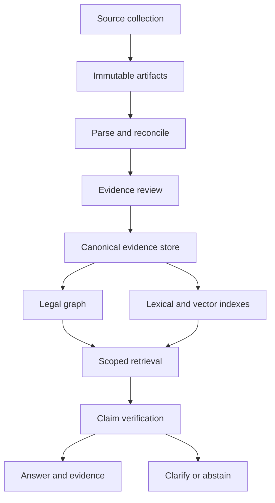

# REG24 — Graph RAG accuracy architecture and build plan

Version 1.1 · 14 November 2026, Asia/Bangkok · Proposed design, not an implemented or certified system

## 1. The decision

Build REG24 as an **evidence-backed, time-aware legal knowledge system**. Use a shared legal graph together with exact citation search, lexical search, semantic retrieval and verified source passages. The graph connects evidence; it does not replace evidence. An answer is released only when its material claims have adequate support for the requested facts, jurisdiction and date.

The goal is the highest defensible accuracy at an affordable cost per useful answer. “Nearly flawless” becomes an engineering program: prevent avoidable errors, detect uncertainty, expose coverage gaps, require review where judgment is material, and continuously measure failures. It is not a promise that an LLM or a finite corpus will never make a mistake. REG24 should earn trust through reproducible evidence and measured performance rather than node counts or confidence scores.

**Recommended delivery:** protect and reconcile the existing build; establish the canonical evidence foundation; prove an end-to-end RD pilot; expand through the approved ten domain batches. Keep the platform model-agnostic and expose the same evidence services to the REG24 application, APIs and authorized agents.

This architecture complements `REG24_GraphRAG_10_Batch_Plan_v1_3.md` and its batch map. That plan controls folder membership and sequence. This document controls proposed quality gates, architecture, retrieval, evaluation and engineering work. Neither document authorizes blindly importing the candidate manifest.

## 2. Evidence, assumptions and current limits

The prior inventory mapped **88 top-level source folders**. The inspected indexes contain **4,571 RD ruling-related rows**, **564 other RD rows**, and **7,527 Council of State opinion rows**. These are index records, not verified unique documents, complete legal coverage or measured overlap with REG24. The candidate manifest has 12,662 unverified records. The subsequent supplied OCR audit now establishes a metadata census; page/content verification remains outstanding, as detailed below.

Selected repository files were reviewed at commit `0978e1d7c578b74c888eb06d9d70be786f387ca0` in `classichot/REG24`. Isolated local behavioral checks showed that the inspected ingestion service recognizes a repeat within one instance but accepts it again in a fresh instance; its field named SHA-256 does not match actual SHA-256; renaming a test ruling changes its work identity. These observations concern that service at that commit. They do not establish the deployed version or prove production already contains duplicates.

The inspected API also supplies fallback legal text and dates when inputs are missing. A graph synchronization path assigns a fixed verification status/date and a blanket primary-statute classification. Production readiness requires eliminating such behavior from production paths or proving those paths are isolated demonstrations. A passing simulated acceptance dashboard is not a production certification.

The live Neo4j graph, deployed authorization middleware, canonical database, search backend, backups, model configuration and capacity have **not** been verified in this work. Gate G0 below resolves them. No production ingestion or code modification has been performed.

Working assumptions: Thai business law is the initial scope; public legal sources form a shared corpus; private workspaces remain isolated; the existing Neo4j installation is retained if its audit passes. Reuse suitable existing storage and search infrastructure. Do not start a database migration merely to match this diagram.

### 14 November OCR audit revision

The user-supplied OCR readiness audit reports a full metadata traversal of 56,064 physical Drive files / 41.2509 GB, including 54,072 PDFs / 33.8328 GB across 88 top-level folders and 534 descendant folders. This supersedes the earlier “descendants not fully enumerated” limitation at metadata level only. Unique legal-work counts, archive contents, exact page counts and OCR demand remain unverified.

The random 120-PDF sample classified 52 as native-extraction candidates, 7 as legacy-font repair, 20 as corrupted repair/OCR, 33 as no usable text and 8 as mixed/review. These are file-level triage outcomes, not page/byte proportions or legal-accuracy scores. No OCR model was benchmarked. Preserve the audit's sampling limits; do not multiply these percentages by storage GB to estimate OCR work.

Require a full page manifest before graph acceptance: probe every page; preserve good native text; apply only source-verified, font-specific deterministic repairs; OCR failing pages/regions; quarantine uncertain critical content. Coordinate-based cleanup must not delete genuine repeated legal text. All pages—including noncontent pages with reasons—must reconcile; unresolved potentially material pages block complete-document publication.

Add safe archive/member and TXT record parsing before expensive OCR. Deka's 5.4649 GB contains only 0.0710 GB of standalone PDFs; its text/archives must not be treated as an OCR byte backlog. Record physical files, expanded members/logical records and canonical works separately, with exact-byte deduplication and unchanged access scopes. Primary Law and BOT/SEC need scan-focused pilots; TISI needs a font-repair-versus-OCR benchmark; RD/opinions prioritize verified native extraction with page checks; B10 books/theses need long-document resumability.

Keep the ten-batch sequence and owner test gate. Extend the shared foundation before B01 to support all five routes; calibration of later-domain fixtures is permitted without ingesting those later domains. Use at-most-50-page OCR tasks and an initial 250 OCR-invoked-page dispatch budget per run within existing document/source-page ceilings; oversized documents continue checkpointed and publish only after complete evidence validation. Record actual OCR attempts separately from final page route counts. These are tunable scheduling limits, not throughput forecasts.

Reforecast each batch from deduplicated page routes, expanded archive records, measured extraction/OCR throughput, critical review hours, graph/evaluation overhead and the owner's testing calendar. No new full-corpus completion date is established by this audit. All existing graph/answer quality, historical-law, replay, citation, authorization and rollback gates remain mandatory. Detailed requirements and AT19–AT26 are in the updated developer package's `03_OCR_AUDIT_ADJUSTMENTS.md`.

Audit source: supplied `REG24_Legal_Resource_OCR_Audit_2026-11-14(1).md`; no independent recrawl or OCR execution occurred during this plan revision.

## 3. What accuracy means

Measure quality at each layer because a correct quotation can still produce an incorrect legal conclusion.

| Layer | Required property | Typical failure to prevent |
|---|---|---|
| Source | Authenticity, provenance and completeness are separately recorded | A corrected derivative presented as an official original |
| Text | Extraction matches the original, especially legally significant tokens | Missing negation, wrong section, percentage or date |
| Identity | One legal work has a stable identity across formats and batches | The same ruling becomes several independent authorities |
| Time | Relevant provisions and transitional rules match the factual date | Today's consolidated text applied to an earlier transaction |
| Authority | Document type and legal effect are accurately represented | An opinion or applicant's position treated as legislation |
| Retrieval | Supporting, qualifying and materially contrary evidence is found | Only favorable rulings retrieved |
| Reasoning | Conditions, exceptions and factual distinctions survive synthesis | A narrow ruling generalized to every taxpayer |
| Answer | Each material claim has supporting evidence or an explicit uncertainty label | A real citation attached to an unsupported statement |
| Operations | Updates, retries, access and withdrawals preserve these properties | Mixed releases, stale caches or private-data exposure |

Use separate status fields, never one overloaded `verified=true`: source authenticity, extraction review, identity resolution, temporal resolution, assertion review and release readiness. A model's self-reported confidence is not a calibrated probability of legal correctness.

## 4. Architecture and technology choices

| Component | Proposed responsibility | Choice |
|---|---|---|
| Artifact store | Immutable source bytes, page images, hashes, fetch receipts and rights metadata | Existing suitable object storage; retention/versioning and recovery enabled |
| Canonical evidence store | Legal identities, versions, assertions, review decisions, durable jobs, release manifests and legacy crosswalk | Transactional relational store; prefer existing Postgres if suitable |
| Graph projection | Typed, evidenced relationships and bounded traversals | Existing Neo4j, after baseline and constraint audit |
| Search projections | Exact identifiers, Thai lexical retrieval and embeddings over accepted passages | Benchmark existing capabilities first; add a search service only if a measured gap warrants it |
| Workers and queue | Download, OCR, extraction, indexing, retry and dead-letter handling | Durable queue; long jobs outside request handlers |
| Answer service | Query planning, retrieval, reranking, evidence verification and response policy | Model adapters with pinned versions and benchmarked fallbacks |
| Review console | Source-page comparison, conflicts, legal versions and release approvals | Extend existing admin workflows where practical |
| Evaluation/observability | Reproducible gold sets, traces, quality gates, cost and incidents | Independent of the answer model; retain replayable evidence bundles |

The canonical store is the authoritative record of accepted knowledge. Neo4j and search indexes are rebuildable projections. Original artifacts remain the source evidence. If the existing architecture assigns these roles differently, G0 must document an equivalent durable design before development proceeds.

Do not adopt a large orchestration framework as an accuracy requirement. Start with explicit, testable stages and typed contracts. Add orchestration infrastructure where retries, branching or operational needs justify it.

Microsoft GraphRAG distinguishes entity/local retrieval from corpus-wide community-report retrieval [R1]. Neo4j provides retrieval patterns combining full-text/vector search and graph expansion [R2]. **REG24 design inference:** use hybrid evidence retrieval for legal questions; reserve community summaries for discovery and corpus overviews. Neither source establishes legal correctness for REG24.

## 5. Canonical legal identity and duplicate protection

Separate five identities:

1. **Legal work:** a ruling, opinion, statute or other identifiable legal document, regardless of filename or download location.
2. **Legal version:** a legally meaningful edition or amended state, supported by evidence. A new scan or corrected OCR is not a legal amendment.
3. **Source representation:** official HTML, official PDF, scan, mirror or derivative linked to its origin. Store SHA-256 of the actual original bytes.
4. **Extraction revision:** output of a specific parser/OCR configuration for that representation. Preserve previous revisions and corrections.
5. **Accepted passage/assertion:** precisely located evidence and reviewed claims derived from a selected extraction/version.

Assign stable opaque canonical IDs through a registry. Use verified issuer, document type, official number, year/date context and identity aliases to resolve works. Never use filename, batch, model name, upload timestamp or OCR text alone as the legal-work ID. Preserve Thai and normalized identifier forms. An opinion number with a range or combined numbers requires inspection; do not manufacture separate opinions by expanding digits blindly.

Matching ladder: legacy crosswalk and verified identifiers → exact artifact match → approved representation mappings → normalized-text similarity for candidates → human review when ambiguous. Similarity can suggest matches but must not silently merge distinct rulings. Identical bytes do not imply identical permissions; access remains attached to each authorized source/context.

Each incoming record receives one of: `SKIP_UNCHANGED`, `ATTACH_REPRESENTATION`, `NEW_EXTRACTION_REVISION`, `NEW_LEGAL_VERSION`, `CREATE_NEW_WORK`, or `REVIEW_IDENTITY_CONFLICT`. Record the reason, evidence, affected IDs, before/after fields and planned write counts in a dry-run manifest.

Persist idempotency keys and complete request fingerprints transactionally. A repeated key with changed material content must conflict. Workers use unique constraints, bounded retries, leases and fencing tokens. Replaying an accepted import after restart, concurrently, or under another batch must create **zero extra canonical works, accepted passages, active vectors or accepted assertions**. Audit receipts may increase.

Existing graph nodes are first crosswalked and evaluated. Do not delete them to make a uniqueness constraint succeed. Preserve public IDs, citation resolution, reviewed metadata and useful provenance. Review consolidation proposals; retain aliases and redirects. Multiple independent sources supporting a claim remain distinct evidence even when retrieval displays one canonical legal work.

## 6. Legal graph schema

| Entity | Essential information |
|---|---|
| LegalWork | Type, issuer, official identifiers, titles, jurisdiction, identity evidence |
| LegalVersion | Version basis, applicable intervals, publication and transition evidence |
| SourceRepresentation | Artifact hash, source URI, origin, retrieval time, authenticity, scope |
| ExtractionRevision | Parser/model/configuration, raw output, corrections, validation result |
| Passage | Exact text, structural path, extraction reference, real source location |
| Provision / ProvisionVersion | Parent instrument, section/paragraph/item identity, versioned text |
| Assertion | Subject, predicate, object/value, scope, qualifiers, evidence and review state |
| Issue / FactPattern | Controlled legal issues and materially relevant facts, with source spans |
| Agency / Court | Resolved institutional identity; capacity/role where relevant |
| ReviewDecision / Release | Reviewer, rationale, revisions, accepted snapshot and projection receipts |

Core predicates include `ISSUED_BY`, `HAS_VERSION`, `REPRESENTED_BY`, `CONTAINS`, `CITES`, `INTERPRETS`, `AMENDS`, `REPEALS`, `HAS_CONDITION`, `HAS_EXCEPTION` and `SUPPORTED_BY`. Distinguish a citation from approval, an interpretation from an amendment, and a possible conflict from an adjudicated contradiction.

Store meaningful relationships as evidence-bearing assertions, even if a direct Neo4j edge is also materialized for speed. Each assertion records source passage IDs, extractor/version, proposition status, legal context, review decision, relevant dates and access scope. An edge without adequate evidence stays proposed and is excluded from authoritative answer paths. Proposed links can still help reviewers find evidence.

Separate source statements from REG24 inferences. Never convert an LLM interpretation into an official holding. Applicant allegations, hypothetical facts, agency reasoning and conclusions receive distinct roles. Anonymous people and companies remain document-scoped unless reliable identity evidence supports linking them. Avoid creating a person/company node for every mention when it adds no retrieval value.

Authority is contextual: record source type, issuer, jurisdiction, legal basis and application limits; have Thai counsel approve the authority policy. Do not encode a universal numeric ranking that treats every court, agency opinion and statute as interchangeable evidence.

## 7. Legal time and changes

Maintain both **legal applicability time** and **system knowledge time**. Store dates as sourced claims with precision and uncertainty, including original Thai date text and normalized values. Publication, commencement, decision date, tax period and transaction date are different fields. Do not infer commencement from upload date. Handle Buddhist/Gregorian year conversion explicitly and validate historical or ambiguous dates.

A provision may have different applicability for different transactions, persons or periods. Model transitional rules and exceptions as conditions, not just one start/end date. If a historical version cannot be established, REG24 can show the source but must not confidently state which law applied.

Support two distinct questions: “What law applied on date D, using today's verified knowledge?” and “What would REG24 have known at snapshot S?” Pin both dimensions in the answer trace. Where an amendment implies a consolidated text, mark the consolidation as derived and retain each amendment's evidence; do not label it an official consolidated source without verification.

Change monitoring uses official-source registries and recorded fetch outcomes. New documents enter the same review pipeline. Use dependency links to invalidate affected provision summaries, answers, embeddings and graph projections. Mark a domain stale when required update checks fail; lack of a new document is not proof that the law is unchanged.

## 8. Source processing and Thai OCR

1. Reconcile index records with recursive file inventory. Check accessibility, format, page count, attachments and completeness. Preserve failed records with reasons rather than silently dropping them.
2. Prefer verified native HTML or readable PDF text where suitable. Test extracted text for missing glyphs, broken encoding, Thai duplication, text order and page coverage. A selectable PDF is not necessarily a clean extraction.
3. Use page-level OCR only where needed. Preserve images and real page coordinates; for HTML use an archived snapshot and stable structural locator. Never fabricate PDF page numbers or bounding boxes for unpaginated text.
4. Preserve raw output and auditable normalization. Correcting whitespace or encoding must not silently change legal content. Use Thai-aware structure and preserve section/subsection notation, lists, footnotes and tables.
5. Flag critical tokens: negation, exception language, dates, amounts, percentages, document numbers, section references and deadlines. Compare suspect regions with the original; use a second extractor selectively. Two agreeing models are still not proof.
6. Require human review for unresolved critical-token differences, uncertain identity, amendments, conflicting versions, incomplete pages and disputed authority. Route routine low-risk extraction through validated automated checks and a sampled audit only after the pilot demonstrates acceptable quality.
7. Store approved corrections as revisions with reviewer and reason. Keep citations pinned to immutable evidence so old answers remain inspectable.

Choose OCR models through a REG24-specific test, not general benchmark popularity. Include clean scans, low-resolution pages, old fonts, mixed Thai/English, tables, footnotes and corrupted text layers. Measure character error rate separately from **critical-token error rate** and page completeness. Compare total cost including human correction time. No OCR vendor or model is declared the winner before this test.

Chunk by legal structure: provision/subsection for legislation; facts/question/reasoning/conclusion for rulings; request/issues/analysis/conclusion for opinions. Preserve parent and neighboring context. Start with approximately 300–800 tokens for normal passages, but do not split a condition from its exception merely to meet a token target. Large sections can use child passages linked to the complete parent.

## 9. RD and Council of State extraction profiles

**RD profile:** official reference, issue date, tax types, relevant tax/transaction periods, facts supplied by the requester, precise questions, department's reasoning and answer, conditions, exceptions, cited provisions and cited rulings. Separate the taxpayer's proposed treatment from RD's response. Similar fact patterns are retrieval aids, not proof that another transaction receives the same treatment.

**Council of State profile:** opinion identifier(s), requesting agency, date, committee or institutional details when evidenced, questions, alternatives considered, reasoning, conclusions, cited instruments/provisions and prior opinions. Keep dissenting or separate positions if present. Missing or garbled index fields must be rechecked in the document, not accepted as graph facts.

For both, preserve source language as authoritative evidence; translations and summaries are labeled derivatives. Do not assume an opinion has the same legal effect as legislation or a judicial decision. The legal policy determines how the answer explains each authority's role.

## 10. Retrieval that matches the question

| Query type | Default path | Required safeguards |
|---|---|---|
| Exact ruling/section lookup | Identifier registry and lexical matching | Resolve ambiguous numbers; retrieve the correct work/version |
| Legal rule or fact-pattern question | Lexical + vector candidates, reranking, bounded graph expansion | Retrieve conditions, exceptions, definitions and evidence of applicability |
| Historical question | Date-aware candidate selection and version traversal | Separate ruling date from applicable transaction/tax period |
| Multi-document analysis | Query decomposition and approved graph traversal templates | Evidence for each hop; find material contrary treatment |
| Broad topic overview | Domain search; optional community summaries to discover leads | Return to primary passages for material legal claims; disclose coverage |
| Tax/deadline calculation | Approved versioned rule engine plus sourced inputs | Deterministic arithmetic; ambiguous legal premises go to review |

Resolve language, jurisdiction, as-of date, workspace, facts and scope before retrieval. Ask a targeted clarification when a missing fact changes the conclusion; otherwise state a bounded assumption and give a conditional answer. Preserve Thai terms and original official identifiers in cross-language searches.

Initial tuning candidates, not fixed production settings: retrieve about 40 lexical and 40 semantic candidates; fuse and deduplicate by canonical work/version; rerank around 30; select 8–15 evidence passages; expand one or two permitted graph hops with strict node and token caps. Evaluate these settings against recall, latency and cost. Dense or multi-issue questions may require a larger bounded research job.

Authorization filters apply before evidence is exposed to retrieval consumers, rerankers or models, and again when citations are resolved. If an index cannot enforce adequate tenant scoping, use separate namespaces/indexes. Never rely on filtering private text after generation. Treat graph traversal, result counts, logs and caches as potential disclosure paths too.

Query-generated Cypher is not the default production path. Prefer parameterized, allowlisted, read-only templates with timeouts and traversal caps. All document text is untrusted data, not instructions. A retrieved document cannot authorize tools, writes or access changes.

## 11. Answer contract and verification

Every response includes a concise answer, relevant assumptions/date, supporting authorities with exact passages, material exceptions or contrary evidence, and unresolved limitations. More detail can sit behind expandable evidence cards. Do not burden users with ingestion internals; expose useful distinctions such as “official source,” “historical version,” and “needs review.”

Construct a claim ledger before finalization. For each material claim record claim type, supporting passage IDs, version/applicability basis, conditions, opposing evidence and verification result. Distinguish direct source statements from legal synthesis. “Source says X” and “X applies to your facts” require different checks.

Verification combines deterministic checks and substantive evaluation: citation IDs resolve; quoted text matches; numbers/dates agree; authority labels match; all material claims have relevant evidence; exceptions have not been dropped; support is not negated elsewhere in the same source. A separate model can flag gaps but does not independently certify correctness. Trigger deeper verification for conflicting sources, historical amendments, calculations, novel fact patterns or weak retrieval.

Response states are `ANSWERED`, `CONDITIONAL`, `NEEDS_CLARIFICATION`, `INSUFFICIENT_EVIDENCE`, and `REVIEW_REQUIRED`. An answer with unresolved material uncertainty must not be presented as a settled conclusion. Provide useful verified findings even when a full answer is unavailable. Measure unnecessary abstention so the system cannot appear accurate merely by refusing difficult questions.

**Human-review boundary:** ordinary retrieval and adequately supported synthesis can be answered automatically after the verification checks. Human approval is mandatory before publishing disputed source corrections, uncertain legal identities, unresolved material OCR tokens, or contested amendment/authority classifications. At query time, `REVIEW_REQUIRED` applies when a decisive conclusion depends on an unresolved conflict of authorities, an unresolved applicable legal version, or a legal rule/calculation that has not been approved for automated application. Missing user facts normally produce `NEEDS_CLARIFICATION`; missing source coverage normally produces `INSUFFICIENT_EVIDENCE`. A novel fact pattern triggers deeper checking, but is not by itself proof that a human must approve every answer.

For `REVIEW_REQUIRED`, return the verified findings and the precise unresolved question without the contested conclusion. Create an internal review ticket containing the authorized evidence bundle and route it to the legal owner. In the first release this is an internal pilot review queue, not a promised real-time legal-advice service. A reviewed response is available only after an assigned qualified reviewer signs a versioned decision; retain the original response and link its replacement. Human waiting time is excluded from the automated-answer latency target and reported separately. Queue limits and visible pending status prevent unbounded commitments. No answer or reviewed decision automatically executes a filing, payment or other legal action.

Do not stream unverified legal conclusions and retract them later. Stream progress or verified excerpts while processing; release substantive conclusions after the gate. An evidence link's existence alone does not prove that the evidence supports the claim. Empirical legal RAG research distinguishes correctness from groundedness and documents failures despite retrieval [R3].

The knowledge API must return at least: request ID, corpus release ID, applicable date, knowledge snapshot, answer status, claims, evidence locators, coverage warnings and model/prompt policy versions. Authorized agents receive the same evidence and abstention rules as human-facing applications. Graph access does not grant autonomous legal execution permission.

## 12. Durable ingestion, promotion and rollback

State machine: `DISCOVERED → FETCHED → EXTRACTED → IDENTITY_RESOLVED → VALIDATED → STAGED → PUBLISHED`. Any stage can enter `REVIEW_REQUIRED`, `RETRY_PENDING` or `REJECTED` with a reason. “Processed” is not “published.” A missing Neo4j connection or an in-memory-only result must be reported as incomplete, not a successful graph release.

Use a transactional outbox from the canonical store to projection workers. Do not pretend there is one distributed transaction across the database, Neo4j, vector search and object storage. Each projection acknowledges a release manifest with counts and checksums. Only switch the active release pointer when all required projections and acceptance checks agree.

Queries pin one release snapshot throughout retrieval and citation resolution. Implement staged generations or equivalent version filters so old and new projections remain distinguishable. Keep the previous release available until in-flight readers finish and recovery policy permits cleanup. A failed release leaves the last healthy release serving traffic.

**Current access controls override historical snapshots.** Recheck current authorization and withdrawal restrictions on every retrieval, citation view, cached-response view and export; recheck again before releasing an in-flight answer. A release snapshot preserves historical knowledge, not an entitlement to revoked content. Block affected excerpts and claims in previously saved answers; if they cannot be separated reliably, block the whole answer and show a restricted-evidence notice. Retain an audit record or tombstone only as permitted by retention/access policy, and provide historical reproduction solely to currently authorized users. Access revocation or source removal is distinct from legal repeal: repealed law normally remains available for historical research, clearly labeled, unless a separate access restriction applies. Already downloaded third-party copies cannot be recalled by this mechanism; revoke future access and record the limitation.

Rollback first restores the active pointer, then reconciles staged changes. Remove only objects exclusively created by the failed release and restore changed values through version history; never delete a shared legal node because it carries a batch tag. Confirm rollback with actual database faults, worker termination and restoration tests.

## 13. Efficiency without silently reducing accuracy

- Use deterministic identity lookup before embeddings or generation.
- OCR only affected pages; cache by artifact hash plus model/configuration, never by filename alone.
- Re-extract and re-embed changed passages only. Keep model/configuration generations explicit.
- Extract legal facts once per accepted version and reuse them; do not rebuild the whole graph for every batch.
- Use validated smaller models for bounded extraction/classification and stronger models for difficult synthesis when benchmarks justify the tradeoff.
- Run an additional critic only on risk triggers or evaluation samples, rather than a permanent committee of models for every lookup.
- Cache with release ID, legal date, jurisdiction, access scope, policy and model versions. Invalidate on evidence change, withdrawal or permission change.
- Bound graph traversal, candidate counts and research iterations. If the budget cannot support a reliable conclusion, return an incomplete/conditional result rather than silently dropping safeguards.

Optimize **cost per correctly supported, useful answer**, including human review and failed attempts. Also record cost per accepted page/document, reviewer minutes, p50/p95 latency, query throughput and update lag.

Provisional pilot objectives: p95 under 2 seconds for exact lookup and under 15 seconds for standard fully verified answers on a declared load profile; deeper research is an asynchronous job. These are engineering targets, not measured performance or promises. G0 defines the benchmark hardware, corpus size and expected concurrency; the pilot calibrates realistic service objectives. Quality gates take precedence over latency tuning.

## 14. Evaluation and release gates

Build a lawyer-adjudicated benchmark before optimizing the system. Start with 300 distinct question families for the RD pilot, then expand to at least 1,000 across released domains. Use separate development and locked holdout sets; split by underlying legal matter/document family and time to reduce leakage. Paraphrases of the same case do not count as independent cases.

Cover exact lookups, fact-pattern comparisons, exceptions, historical law, contrary authorities, incomplete facts, nonexistent citations, false premises, Thai/English questions, OCR damage, table values, combined opinion numbers, private-data isolation and document prompt injection. Include genuinely answerable and unanswerable cases, labeled before evaluating the system. Gold answers identify acceptable alternative authorities and decisive evidence, not just one preferred sentence.

Two qualified reviewers independently score the critical/holdout cases; adjudicate disagreements. Use automated judges for triage and scale, not as the sole release authority. Retain failed cases in regression tests while keeping fresh unseen holdouts for future measurement.

**Proposed release targets — not current measured results:**

| Metric | Initial gate | Measurement |
|---|---|---|
| Citation resolvability | 100% of generated material citations resolve to authorized immutable evidence | Automated check of every evaluation answer and every released response |
| Replay/concurrency integrity | Zero duplicate accepted knowledge objects in the defined test matrix | Same worker, restart, concurrent workers, different batch and format |
| Access isolation | Zero unauthorized disclosures in the defined security tests | Retrieval, graph, citation, cache and export adversarial tests |
| Critical metadata | 100% checked in pilot; no unresolved identity/date/authority conflicts in released items | Source comparison; explicit unknown values allowed with answer restrictions |
| Critical OCR defects | Zero unresolved meaning-changing defects in pilot accepted evidence | Human review of the entire pilot; stratified audits when scaling |
| Exact identifier retrieval | 100% correct on unambiguous in-corpus test lookups | Include Thai digits, variants and collisions |
| Evidence recall@20 | At least 98% overall; report each important slice | Fraction of adjudicated decisive evidence units retrieved among top 20; also track complete-evidence-set recall |
| Material claim support | Target at least 99.5% | Human-adjudicated supported material claims / evaluated material claims, including qualified synthesis |
| End-to-end legal correctness | At least 98% on answerable holdout questions | Whole answer correct and materially complete for specified facts/date |
| Critical answer defects | Zero observed in release holdout | Wrong outcome/rate/deadline, invented authority, privacy leak or misleading omission that changes conclusion |
| False confident answers | Zero observed on designated unanswerable/false-premise critical cases | Correct clarification, correction or abstention required |
| Useful answer coverage | At least 90% of designated in-scope answerable cases | Correct useful responses / all such cases; exclusions fixed in advance |

Report numerator, denominator, severity, domain and confidence intervals. A target percentage is not demonstrated when the sample is too small. With zero independent errors, the approximate 95% upper error bound is 3/n: zero errors in 300 cases does not establish a 0.1% error rate. Claims from the same case are correlated; compute uncertainty at question/document-family level and disclose limits. Treat a small clean pilot as permission for controlled expansion, not a “99.9% accurate” marketing claim.

Use quality-versus-coverage curves, not one accuracy score. A system that gets easy questions right but misses amendments or abstains on most real requests is not ready. Any critical defect blocks the affected release/feature, receives root-cause review and a regression case. Broader coverage claims require evidence beyond the initial RD benchmark.

Compare four configurations on the same test set: exact/lexical baseline; lexical+vector; hybrid plus reranking; hybrid plus graph plus verification. Add community summaries only if they improve the intended query class. Keep each added layer only when its quality benefit justifies its cost and operational burden.

## 15. Engineering roadmap

| Gate | Work package | Deliverable and exit condition | Lead responsibility |
|---|---|---|---|
| G0 — Protect current build | Verify deployment, data stores, IDs, constraints, authorization, backups and duplicate baseline | Restorable isolated snapshot; deployed architecture inventory; no unknown write paths | Backend/platform lead |
| G1 — Establish canonical evidence | Durable jobs, real hashes, identity registry, legacy crosswalk, representations and source locators | Replay/concurrency suite passes; no fabricated defaults; staged dry-run reviewed | Backend/data engineer |
| G2 — Establish legal structure | OCR evaluation, RD/CoS schemas, legal-time model, authority policy and review console | Accepted pilot evidence; critical fields source-checked; lawyer-approved annotation guide | Legal lead + data/ML engineer |
| G3 — Deliver trustworthy answers | Hybrid retrieval, version filtering, bounded graph expansion, claim ledger, citation viewer and abstention | Locked pilot benchmark meets gates; baseline comparison proves benefit | Retrieval/ML lead |
| G4 — Release RD pilot | Projection coordination, fault recovery, canary and monitoring | Restore/rollback passes; controlled user acceptance; release signed by engineering and legal owners | Platform + QA + legal |
| G5 — Expand ten batches | Gated processing runs, dependency ingestion, per-domain gold cases | Each batch meets shared and domain-specific gates before expansion | Data operations + domain reviewer |
| G6 — Operate continuously | Update monitoring, correction loop, red-team tests and model upgrades | Freshness dashboard, incident playbooks, recurring evaluation and dependency invalidation | Operations + quality owner |

G0/G1 are prerequisites for production ingestion. G2's annotation policy and benchmark drafting can begin alongside foundation engineering. G3 requires accepted source evidence and stable identities. G4 cannot be replaced by a demonstration with synthetic records. G5 proceeds incrementally; there is no need to finish every source folder before REG24 becomes useful.

Suggested responsibility coverage: one accountable technical lead, backend/data engineering, retrieval/OCR engineering, QA/platform support, and a Thai legal lead with trained reviewers. People may cover more than one role, but extraction authors should not be the sole judges of disputed legal content. The legal owner resolves authority/version disputes; engineering owns system integrity; both approve releases.

Do not commit a full-corpus completion date from index row counts. During the pilot measure accepted pages/hour, OCR fallback rate, reviewer minutes/document, duplication rate and projection throughput. Forecast each batch as the maximum of its compute and review critical paths plus rework/release overhead. Budget separately for ingestion, ongoing queries, legal review, storage and updates. G0 and pilot results convert this milestone plan into a staffed calendar.

## 16. Approved ten-batch rollout

Retain the requested original order **01 → 03 → 04 → 05 → 06 → 07 → 09 → 02 → 08 → 10**, renumbered below. Council of State opinions therefore remain **B08**, while Council of State legislation belongs with B02.

| New batch | Original group | Release scope |
|---|---|---|
| B01 | 01 | RD rulings |
| B02 | 03 | Statutes and tax framework |
| B03 | 04 | Corporate, investment and commerce |
| B04 | 05 | Financial services and capital markets |
| B05 | 06 | Employment, data and digital business |
| B06 | 07 | Energy, environment and industry |
| B07 | 09 | Health, property, transport and other sectors |
| B08 | 02 | Council of State opinions |
| B09 | 08 | Public administration, procurement and oversight |
| B10 | 10 | Courts, enforcement and research |

Load necessary cited provisions and decisions as dependencies before the owning batch, preserving `owner_batch_id` and `first_loaded_by_batch_id`. This avoids making tax answers depend on waiting for the entire statutes or courts release. An unresolved dependency limits the associated answer; it is not filled by model memory.

**B01 pilot:** 100 verified unique rulings: CIT 30, VAT 25, WHT 15, PIT 10, Stamp 5, SBT 5, General/Other 10. Select diverse years, source qualities and legal difficulty rather than only easy PDFs. Include duplicates/renamed representations in a separate replay test set; these do not increase the unique-work quota. Review all pilot critical evidence and supporting law versions. Start subsequent processing runs at the smaller of 200 documents or 1,000 pages, then adjust using measured quality and reviewer capacity.

**B08 pilot:** 50 verified unique opinions: tax/public finance 15, administrative procedure 15, public contracts 10, business/sector 10. Start subsequent runs at the smaller of 100 opinions or 1,000 pages. Reuse already accepted laws and cross-batch identities. The pilot structure is a sampling proposal, not a claim that those categories have already been verified in the collection.

Every run produces counts for discovered, inaccessible, duplicate, new-work, new-version, reviewed, quarantined and published records; changed graph/search objects; cost; review workload; coverage gaps; and rollback identity. Never equate “all index rows processed” with “all Thai law covered.”

## 17. Production assurance and correction loop

Provide a coverage registry by jurisdiction, domain, source, year and document type: expected inventory where known, verified count, missing ranges, update timestamp and last successful official-source check. Answers disclose materially relevant gaps. “No result found” must not become “no legal requirement exists.”

Monitor failures by cause: source acquisition, OCR, identity, time, authority, retrieval, reasoning, citation, access and release consistency. User-reported errors create review tickets linked to the answer trace and evidence. Correct the canonical source of the problem, rerun impacted evaluations, invalidate dependent outputs and publish a correction record.

For a severe error, suspend the affected answer route/domain or revert its release while retaining safe exact-source access where possible. Restore after cause, scope and regression coverage are understood. Track time to detection and correction, not only uptime. Model, embedding, prompt, schema and OCR upgrades all require a shadow comparison and release decision; never silently swap models under a validated quality claim.

Reviewer access is role-based; tenant identities and permissions come from verified authentication rather than arbitrary request headers or submitted reviewer names. Approval actions need audit history and concurrency guards. Confirm deployment-level controls in G0 before declaring any specific endpoint vulnerable or safe.

## 18. Definition of the first successful milestone

The first milestone is **a trustworthy RD research slice**, not a giant graph. It is complete when REG24 can:

1. Import the selected 100 unique rulings and required legal dependencies without corrupting existing knowledge.
2. Re-import, restart and run concurrent workers without duplicate accepted knowledge.
3. Show the original passage behind each material answer claim and explain the relevant date, conditions and authority type.
4. Distinguish materially different facts, conflicting interpretations and insufficient evidence.
5. Meet the declared pilot evaluation gates with reviewer adjudication and honest sample-size reporting.
6. Demonstrate rollback, source correction, permission isolation and recovery from projection failure.
7. Produce a measured cost/capacity forecast and a clear go/no-go decision for the next processing run.

This gives REG24 a foundation that improves with every batch while keeping prior evidence, citations and legal versions intact.

## References and evidence register

External references establish technical patterns and limitations, not the legal accuracy of this proposed design. All thresholds and implementation choices above are REG24 proposals requiring validation.

- **R1 — Microsoft GraphRAG query overview:** [official documentation](https://microsoft.github.io/graphrag/query/overview/). Local, global, DRIFT and basic retrieval have different purposes; global search uses community reports.
- **R2 — Neo4j GraphRAG retrievers:** [official user guide](https://neo4j.com/docs/neo4j-graphrag-python/current/user_guide_rag.html). Hybrid retrieval combines full-text and vector indexes; retrieval queries can expand context through the graph. This is an architectural reference, not a requirement to adopt its Python library.
- **R3 — Magesh et al., Hallucination-Free? Assessing the Reliability of Leading AI Legal Research Tools:** [original research paper](https://law.stanford.edu/wp-content/uploads/2024/05/Legal_RAG_Hallucinations.pdf). Evidence that retrieval does not eliminate legal hallucination and that groundedness differs from correctness. Its results are not a benchmark of REG24 or Thai law.
- **S1 — Source collection:** [Legal Database Resource Master](https://drive.google.com/drive/folders/1Q81SV8sXWFrt9ASLf8uBsezFMd1d1Ltm).
- **S2 — RD inventory:** [RD Index](https://docs.google.com/spreadsheets/d/1ZJAUx7mYQR5yvdSdZoM8gvtDloGiqc0WAWyGNSHlW9U/edit).
- **S3 — Council of State inventory:** [current index](https://docs.google.com/spreadsheets/d/1S6CNwilzltq51DIjh2sBMOP_5QwfBxwAE-pA9OkIZRo/edit), tab `INDEX - Council of State Opinions`.
- **C1 — Inspected ingestion service:** [pinned source](https://github.com/classichot/REG24/blob/0978e1d7c578b74c888eb06d9d70be786f387ca0/src/core/ingestion/knowledge-ingestion-pipeline.ts).
- **C2 — Inspected ingestion API:** [pinned source](https://github.com/classichot/REG24/blob/0978e1d7c578b74c888eb06d9d70be786f387ca0/src/app/api/v1/ingestion/pipeline/route.ts).
- **C3 — Inspected graph synchronization:** [pinned source](https://github.com/classichot/REG24/blob/0978e1d7c578b74c888eb06d9d70be786f387ca0/src/core/ingestion/legal-chunk-neo4j-sync.ts).
- **C4 — Graph constraints:** [pinned source](https://github.com/classichot/REG24/blob/0978e1d7c578b74c888eb06d9d70be786f387ca0/src/core/graph/graph-schema.ts). Definitions in code are not evidence that constraints are installed in production.

Companion planning artifacts: `REG24_GraphRAG_10_Batch_Plan_v1_3.md`, `REG24_GraphRAG_10_Batch_Map_v1_3.json`, and `REG24_RD_OCS_Candidate_Manifest_v1_1.json`. The manifest remains an unverified candidate list.
